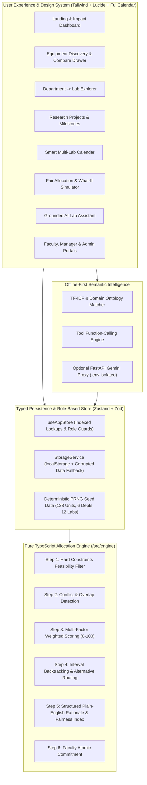

# LabLink — GenAI-Powered Campus Laboratory Resource-Sharing Platform

[](https://www.typescriptlang.org/)
[](https://vitejs.dev/)
[](https://tailwindcss.com/)
[](https://vitest.dev/)
[](https://www.w3.org/WAI/standards-guidelines/wcag/)

> **LabLink** breaks down institutional silos across university engineering, life science, and robotics laboratories. It empowers students to discover 120+ specialized apparatus across departments, maps project needs with semantic AI, and eliminates scheduling deadlocks using a transparent, deterministic, explainable Fair Allocation Engine.

---

## 💻 How to Run LabLink (Step-by-Step)

### Prerequisites
- **Node.js**: `v18.0.0` or higher (tested on Node v20 / v24)
- **npm**: `v9.0.0` or higher (or `pnpm` / `yarn`)
- **Git**

---

### Step 1: Clone the Repository
```bash
git clone <repository-url>
cd "prompt wars"
```

---

### Step 2: Install Dependencies
```bash
npm install
```

---

### Step 3: Run the Local Development Server
```bash
npm run dev
```
Open your browser and navigate to:
```
http://localhost:3000
```
*(or the local port displayed in your terminal)*

---

### Step 4: Run the Test Suites
Run all 23 Vitest unit tests (engine feasibility, multi-factor scoring, tie-breaking determinism, Jain's fairness index, What-If simulation) and component tests:
```bash
npm test
```

To run strict TypeScript type-checking without emitting files:
```bash
npm run typecheck
```

---

### Step 5: Build for Production
```bash
npm run build
```
To preview the production build locally:
```bash
npm run preview
```

---

### Step 6: (Optional) Run the Backend FastAPI & Gemini Proxy Service
The frontend web app runs **100% offline and self-contained** in the browser using the pure TypeScript allocation engine. If you wish to optionally run the Python FastAPI service:

1. Navigate to `/server`:
   ```bash
   cd server
   python -m venv .venv
   # Windows:
   .venv\Scripts\activate
   # Linux/macOS:
   source .venv/bin/activate
   pip install -r requirements.txt
   ```
2. Configure environment variables (copy from template):
   ```bash
   cp ../.env.example .env
   # Add your optional GEMINI_API_KEY inside server/.env
   ```
3. Start the FastAPI server:
   ```bash
   uvicorn main:app --reload --port 8000
   ```

---

### Step 7: (Optional) Connect Supabase PostgreSQL Backend
LabLink includes full support for a live Supabase PostgreSQL database with automatic offline fallback:
1. Follow the step-by-step setup in [SUPABASE_SETUP.md](SUPABASE_SETUP.md).
2. Run the migration script in `supabase/migrations/20261123_init.sql`.
3. Provide `VITE_SUPABASE_URL` and `VITE_SUPABASE_ANON_KEY` in `.env`.
4. The app will automatically connect and sync, or click **"Push Seed Data to Supabase"** from the Admin Portal!

---

## 🎮 How to Use & Explore the Demo

- **NO Login Required**: Opens directly into an active, populated campus dashboard.
- **Role Switcher**: Click the **"Role: [Persona]"** dropdown in the top bar to freely switch personas between:
  - 🎓 **Student Researcher** (Aarav Sharma) — Browse equipment, create projects, request slots.
  - 🔮 **Faculty Advisor** (Prof. Marcus Chen) — Review priority-sorted queue, inspect score rationales, approve allocations.
  - 🛠️ **Lab Manager** (Dr. Victor Stone) — Toggle equipment availability/condition, schedule maintenance, simulate physical QR scans.
  - 🛡️ **Campus Administrator** (Dean Arthur Pendelton) — Tune engine weights, inspect campus-wide audit trails.
- **Guided Demo Tour**: Click the **"Guided Tour (Hero Demo)"** button in the top navigation bar or on the dashboard hero banner for an interactive spotlight walkthrough of the hero conflict scenario.
- **Reset Demo**: Click **"Reset Demo"** in the top bar to wipe any simulated session state and restore the pristine deterministic seed dataset.
- **Command Palette**: Press `Ctrl+K` (or `Cmd+K`) from any screen to search across equipment, laboratories, projects, and execute quick actions.

---

## 🏛️ Architecture & System Topology



---

## 🌟 Hero Demo Workflow: High-Contention DGX A100 Contention

1. **Student Project Creation & AI Analysis**:
   - Navigate to **Projects & Requirements**. Select project *"Autonomous Drone Swarm Cooperative Navigation in GPS-Denied Tunnels"* (Lead: Aarav Sharma).
   - Click **"Analyse with AI"**. The semantic ontology extractor infers hardware requirements: **GPU & AI Workstations** ($\ge 24\text{GB}$ VRAM) and **Robotics & Autonomous Systems**, matching the **NVIDIA DGX Station A100 (4x 80GB SXM4)** with a 95% match score.
2. **Contention & Conflict Detection**:
   - Two rival teams also submitted overlapping booking requests for the same DGX Station A100 on Nov 25:
     - Elena Rostova (CS): Fine-tuning a 70B vision-language histology model.
     - Mateo Morales (Robotics): Temporal neural EMG decoder training.
   - All three teams face impending conference deadlines, producing a three-way cross-departmental contention.
3. **Execution of the Fair Allocation Engine**:
   - Open **Fair Allocation Engine** and select the **★ Hero Scenario**.
   - Click **"Execute Allocation Engine"**:
     - **Aarav Sharma** is awarded the primary slot ($14:00 - 18:00\text{ UTC}$) with top composite score ($69.8/100$), driven by Critical Project Priority, approaching IEEE deadline, and low prior usage ($14\text{h}$).
     - **Elena Rostova** is automatically routed to equivalent hardware (**NVIDIA H100 SuperServer Node 01**) at her exact requested time ($15:00 - 19:00\text{ UTC}$), resulting in zero delay.
     - **Mateo Morales** is offered the nearest collision-free alternative slot.
     - **Jain's Fairness Index** improves from $0.62$ (FCFS baseline) to $0.89$.
4. **Faculty Governance & Atomic Commitment**:
   - Switch active persona to **Faculty Advisor** in the top bar.
   - Open the **Faculty Portal**.
   - Review the priority-sorted queue, inspect score factor contributions, and click **"Approve Recommendation"**.
   - Approval atomically commits confirmed bookings, updates the **Smart Booking Calendar**, sends in-app notifications, and appends an immutable audit log entry.

---

## ⚖️ Mathematical Formulation of the Allocation Engine

For any feasible request $i$, the composite priority score is computed as:

$$\text{Score}_i = w_1 \cdot \text{Urgency}_i + w_2 \cdot \text{Priority}_i + w_3 \cdot \text{Waiting}_i + w_4 \cdot \text{Fairness}_i + w_5 \cdot \text{Criticality}_i$$

where $\sum_{k=1}^5 w_k = 1.0$ (configurable in Admin & What-If simulator). Default weights:
- **Deadline Urgency ($w_1 = 0.30$)**: Proximity to thesis or conference submission deadline.
- **Project Priority ($w_2 = 0.20$)**: Critical ($100$), High ($80$), Normal ($50$), Low ($25$).
- **Waiting Time ($w_3 = 0.20$)**: Elapsed queue time normalized against a 72-hour window.
- **Usage Fairness ($w_4 = 0.15$)**: Inversely proportional to student historical usage ($100 - (\text{hours}/80) \times 100$).
- **Requirement Criticality ($w_5 = 0.15$)**: Direct hardware requirement match ($100$), Category match ($75$), General ($40$).

### Jain's Fairness Index
Equity of access across student usage hours $x_1, \dots, x_n$ is quantified using Jain's Fairness Index:

$$J(x) = \frac{\left(\sum_{i=1}^n x_i\right)^2}{n \cdot \sum_{i=1}^n x_i^2}$$

---

## 📁 Repository Structure

```
├── .github/workflows/ci.yml       # GitHub Actions CI workflow
├── e2e/hero-workflow.spec.ts      # Playwright E2E test suite
├── server/                        # Optional Python FastAPI service
│   ├── main.py                    # OR-Tools & Gemini Proxy API
│   └── requirements.txt
├── src/
│   ├── __tests__/                 # RTL Component tests
│   ├── components/
│   │   ├── common/                # GuidedTourModal, Shared widgets
│   │   ├── layout/                # AppShell, TopBar, Sidebar, CommandPalette
│   │   └── ui/                    # Button, Card, Modal, Drawer, StatusChip, Input, Tabs
│   ├── data/
│   │   ├── prng.ts                # Mulberry32 deterministic PRNG
│   │   ├── seedData.ts            # Departments, labs, initial seed state
│   │   ├── equipmentData.ts       # 128 campus equipment generator
│   │   ├── mockUsersAndProjects.ts# 30 students, 10 faculty, 15 projects
│   │   └── mockBookingsAndConflicts.ts # 40 bookings & 3 conflict cases
│   ├── engine/                    # Pure TypeScript deterministic engine (ZERO UI imports)
│   │   ├── index.ts               # runAllocationEngine entry point
│   │   ├── feasibility.ts         # Hard constraint feasibility filter
│   │   ├── scoring.ts             # 5-factor scoring normalization
│   │   ├── scheduler.ts           # Interval backtracking & alternative routing
│   │   ├── fairness.ts            # Jain's Fairness Index
│   │   ├── explain.ts             # Plain-English rationales & breakdown
│   │   ├── simulator.ts           # What-If scenario comparator
│   │   ├── aiExtractor.ts         # TF-IDF & ontology requirement extractor
│   │   ├── assistantService.ts    # Tool function-calling store query engine
│   │   └── __tests__/engine.test.ts # 17 Vitest engine unit tests
│   ├── features/
│   │   ├── analytics/             # Impact analytics, charts & CSV export
│   │   ├── assistant/             # Grounded AI Assistant chat page
│   │   ├── calendar/              # FullCalendar & accessible list view
│   │   ├── conflicts/             # Conflict resolution & What-If simulator
│   │   ├── dashboard/             # Landing page, KPIs, utilization charts
│   │   ├── discovery/             # Equipment cards, detail drawer, compare modal
│   │   ├── labs/                  # Laboratory explorer & facility drill-down
│   │   ├── portals/               # Faculty, Lab Manager, Admin portals
│   │   └── projects/              # Projects & AI requirement analysis
│   ├── lib/                       # Utils and constants
│   ├── store/
│   │   ├── storage.ts             # Zod validated typed storage layer
│   │   └── useAppStore.ts         # Zustand store with RBAC guards
│   ├── types/index.ts             # Strict TypeScript domain types
│   ├── App.tsx                    # Route-level code-splitting & router
│   ├── index.css                  # Tailwind styles & WCAG motion overrides
│   └── main.tsx                   # React root entry
├── .env.example                   # Environment variable template
├── .gitignore                     # Production-grade gitignore
├── package.json                   # Dependencies & npm scripts
├── playwright.config.ts           # Playwright E2E configuration
├── SECURITY.md                    # Threat model & zero-secret architecture
├── tailwind.config.js             # Design tokens & color system
├── TESTING.md                     # Comprehensive test matrix & instructions
├── tsconfig.json                  # Strict TypeScript configuration
├── vercel.json                    # CSP & HTTP security headers for Vercel
└── vite.config.ts                 # Vite bundler, chunks & Vitest config
```

---

## 📄 License
This project is licensed under the MIT License.
